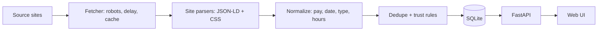

# PLAN.md: International Student Job Discovery Tool (GradGuide Assignment)

> Read this whole file before writing any code. Work phase by phase. At the end of every phase, stop, summarize what was built, and wait for the human to confirm before starting the next phase.

---

## 0. Rules for the coding agent (non-negotiable)

These come from the assignment brief and from the fact that the human must explain every line in a follow-up interview.

1. **The scraper must be our own code.** Fetch pages with `requests`, parse HTML with `BeautifulSoup`/`lxml`, structure data into listings. No job APIs (Indeed, LinkedIn, Adzuna, etc.). No AI/LLM scraping services, and **no LLM calls anywhere in the data pipeline**.
2. **Do not scrape sites that prohibit it.** Before adding any source, check `robots.txt` and the site's terms. Record the result in `docs/SOURCES.md`. Skip LinkedIn, Indeed, Seek, Glassdoor and any login-gated site.
3. **Rules live in data, not code.** Visa hour caps, minimum wage, keyword lists and scam phrases go in `config/*.yaml`. Code reads them.
4. **No invented facts.** Where this plan says `VERIFY`, the human must confirm the value from an official government page. Leave a `# VERIFY` comment next to it. Never present unverified figures as authoritative in the UI.
5. **Explainability over cleverness.** Prefer plain, small functions over abstractions. Every module gets a module docstring explaining what it does and why. Every non-obvious decision is added to `docs/DECISIONS.md`.
6. **Test parsers against saved HTML fixtures**, never against the live web.
7. **Small commits** with clear messages, one logical change per commit.
8. **Ask, don't guess.** If a site's structure, a requirement or a value is unclear, stop and ask the human.
9. **Not an approval or legal tool.** UI copy must say visa and trust information is decision support, not legal advice.

---

## 1. Product summary

A job discovery tool for **international students** covering **part-time/casual**, **full-time** and **internship** roles, including everyday jobs (cafes, retail, delivery, tutoring), built on **our own scraper**.

**Listing view must show:** title, employer, location, pay, job type, posted date.

**Three original features:**

1. **Work-hour awareness:** warns when a job would push a student over their visa work-hour cap.
2. **Employer trust signals:** transparent, rules-based red-flag detection with visible reasons.
3. **Application tracker with follow-up reminders.**

*(Optional stretch, only if everything else is done: campus proximity using haversine distance.)*

---

## 2. Assumptions and configuration

| Item | Assumption | Status |
|---|---|---|
| Target country | **Australia** (default, because "casual" roles and student work caps are well-defined there) | Human to confirm. Country must stay swappable via config. |
| Visa work-hour cap | Fortnightly cap for student visas during study periods | **VERIFY** on the official government site before use |
| Minimum wage | National minimum wage (hourly) | **VERIFY** current value |
| Language | Python 3.11+ | |
| Backend | FastAPI + SQLite | |
| Frontend | React + Vite, built to static assets served by FastAPI | |
| Testing | pytest | |

If the human picks a different country, only `config/` files and the source list change.

---

## 3. Tech stack

- **Scraping:** `requests`, `beautifulsoup4`, `lxml`, `urllib.robotparser` (stdlib)
- **Data models/validation:** `pydantic`
- **Storage:** `sqlite3` (stdlib) with plain SQL. Avoid an ORM so queries are easy to explain.
- **API:** `fastapi`, `uvicorn`
- **Config:** `pyyaml`
- **Tests:** `pytest`
- **Dates:** `python-dateutil` (for relative-date parsing helpers)
- **Optional:** `playwright` only if a chosen source truly needs JavaScript rendering. Prefer sources that don't.

`requirements.txt` must pin versions.

---

## 4. Repository structure

```
job-discovery-tool/
├── README.md                  # overview, run instructions, video link
├── PLAN.md                    # this file
├── requirements.txt
├── config/
│   ├── sources.yaml           # list of enabled scrape sources + settings
│   ├── visa_rules.yaml        # per-country work-hour caps (VERIFY)
│   ├── pay_rules.yaml         # minimum wage per country (VERIFY)
│   ├── job_type_rules.yaml    # keyword lists for classification
│   └── trust_rules.yaml       # scam/red-flag phrases and weights
├── scraper/
│   ├── __init__.py
│   ├── fetcher.py             # polite HTTP: UA, delay, retries, robots.txt, caching
│   ├── base.py                # BaseScraper abstract class
│   ├── jsonld.py              # JSON-LD JobPosting extractor
│   ├── sources/
│   │   ├── __init__.py
│   │   └── <one_file_per_site>.py
│   └── run.py                 # CLI entry: run all or one scraper
├── pipeline/
│   ├── __init__.py
│   ├── models.py              # pydantic Job model
│   ├── normalize.py           # pay, date, type, hours parsing
│   ├── dedupe.py
│   └── trust.py               # trust signal rules engine
├── db/
│   ├── schema.sql
│   ├── database.py            # connection + helpers
│   └── seed.py                # loads demo data from fixtures
├── api/
│   ├── main.py                # FastAPI app
│   ├── routes_jobs.py
│   ├── routes_tracker.py
│   └── routes_profile.py
├── frontend/
│   ├── package.json
│   ├── vite.config.js
│   ├── index.html
│   └── src/
│       ├── App.jsx
│       ├── main.jsx
│       └── styles.css
├── data/
│   ├── raw/                   # saved raw HTML per source/date (gitignored except fixtures)
│   └── jobs.db                # SQLite file (gitignored; seed script recreates it)
├── tests/
│   ├── fixtures/              # saved HTML pages, committed
│   ├── test_parsers.py
│   ├── test_normalize.py
│   ├── test_trust.py
│   ├── test_visa.py
│   └── test_api.py
└── docs/
    ├── ARCHITECTURE.md
    ├── SOURCES.md
    ├── DECISIONS.md
    ├── WRITEUP.md             # 1-page write-up required by the brief
    ├── INTERVIEW_PREP.md
    └── modules/               # one short explainer per module
```

---

## 5. Phases

### Phase 0: Source spike (human + agent, no app code yet)

**Goal:** choose 3 to 4 scrape-friendly sources before building anything.

**Tasks**
1. Human proposes candidate sites. Agent helps evaluate them. Target mix:
   - 1 to 2 cafe/retail/hospitality chain **career pages** (part-time/casual coverage)
   - 1 local job board or campus job board
   - 1 internship source
2. For each candidate, check and record in `docs/SOURCES.md`:
   - `robots.txt` allows the relevant paths
   - Terms of service do not forbid scraping
   - Listings appear in the **raw HTML** (view source, not browser DevTools DOM). Use `curl` or `requests` to confirm.
   - Presence of `<script type="application/ld+json">` with `JobPosting` data
   - Pagination pattern
   - Whether pay is shown
3. Save one raw listing-page HTML and one detail-page HTML per source into `tests/fixtures/<source>/`.

**Reject** any source that requires login, blocks plain `requests`, or has no usable HTML.

**Deliverable:** `docs/SOURCES.md` with a table (source, URL, robots result, ToS note, JSON-LD yes/no, JS required yes/no, decision).

**Done when:** at least 3 approved sources and their fixtures are committed. **Stop and confirm with the human.**

---

### Phase 1: Project scaffolding

**Tasks**
- Create the folder structure from Section 4.
- Add `requirements.txt`, `.gitignore` (ignore `data/jobs.db`, `data/raw/`, `.venv`, `__pycache__`), and a minimal `README.md` with setup steps.
- Add `docs/DECISIONS.md` with a template (Date | Decision | Alternatives considered | Why).
- Set up pytest with one passing placeholder test.

**Done when:** `pip install -r requirements.txt` and `pytest` both succeed from a clean clone.

---

### Phase 2: Scraper core

**2.1 `scraper/fetcher.py`**
- `Fetcher` class with:
  - Custom `User-Agent` identifying the project (e.g. `GradGuideStudentJobTool/0.1 (educational project)`)
  - Configurable delay between requests (default 1.5 s)
  - Retries with exponential backoff on 429/5xx and network errors (max 3)
  - `robots.txt` check via `urllib.robotparser`, cached per host. Refuse disallowed URLs and log.
  - Timeouts on every request
  - Raw HTML cache: save responses to `data/raw/<source>/<timestamp>_<hash>.html`
  - Optional `offline=True` mode that reads from fixtures instead of the network (used by tests and demo)
- Return a small `FetchResult` (url, status, html, fetched_at, from_cache).

**2.2 `scraper/jsonld.py`**
- Function `extract_jobposting_jsonld(html) -> list[dict]` that finds every `application/ld+json` block, tolerates invalid JSON, handles lists and `@graph`, and returns objects whose `@type` is `JobPosting`.
- Helper to map JSON-LD fields (`title`, `hiringOrganization`, `jobLocation`, `baseSalary`, `employmentType`, `datePosted`, `description`) into our raw dict.

**2.3 `scraper/base.py`**
```python
class BaseScraper(ABC):
    name: str                      # matches config/sources.yaml
    def __init__(self, fetcher, config): ...
    @abstractmethod
    def list_urls(self) -> Iterable[str]: ...          # listing/pagination URLs
    @abstractmethod
    def parse_listing(self, html: str, url: str) -> list[RawJob]: ...
    def parse_detail(self, html: str, url: str) -> RawJob | None:  # optional
        return None
    def run(self) -> ScrapeResult: ...                 # orchestrates fetch -> parse, collects errors
```
- `RawJob` is a plain dict or dataclass of **unnormalized strings** (title, employer, location, pay_text, type_text, posted_text, url, description, source).
- `run()` must never crash on one bad page. It catches, logs and counts errors, and continues.

**Done when:** unit tests cover robots refusal, retry logic (mocked), and JSON-LD extraction (using fixtures). Add `docs/modules/scraper_core.md` explaining the design.

---

### Phase 3: Site scrapers (one per approved source)

For each source in `docs/SOURCES.md`:
1. Create `scraper/sources/<name>.py` subclassing `BaseScraper`.
2. Prefer JSON-LD, fall back to CSS selectors. Comment **why each selector was chosen**.
3. Handle pagination with a hard page limit from config (default 10).
4. Write tests in `tests/test_parsers.py` that run the parser on the saved fixtures and assert on specific expected fields.
5. Register the scraper in `config/sources.yaml`:
   ```yaml
   sources:
     - name: example_cafe_chain
       enabled: true
       base_url: ...        # filled from SOURCES.md
       max_pages: 5
       default_job_type_hint: part_time
   ```
6. `scraper/run.py` CLI:
   ```
   python -m scraper.run --all
   python -m scraper.run --source <name>
   python -m scraper.run --offline        # use fixtures
   ```

**Done when:** each scraper returns at least 10 real, structured listings from its fixtures, tests pass, and **part-time/casual roles are clearly represented in the total**. Stop and confirm.

---

### Phase 4: Normalization pipeline

**4.1 `pipeline/models.py`: canonical `Job` model**

| Field | Type | Notes |
|---|---|---|
| id | str | stable hash |
| source | str | |
| url | str | |
| title | str | |
| employer | str | |
| location_text | str | |
| city | str \| None | |
| lat, lng | float \| None | optional, only for stretch |
| job_type | enum | `part_time`, `casual`, `full_time`, `internship`, `unknown` |
| category | str \| None | cafe, retail, delivery, tutoring, tech, other (rule-based) |
| pay_min, pay_max | float \| None | |
| pay_unit | enum | `hour`, `day`, `week`, `year`, `unknown` |
| pay_text | str | original string preserved |
| hours_per_week_min, hours_per_week_max | float \| None | parsed when stated |
| posted_date | date \| None | |
| description | str | |
| first_seen, last_seen | datetime | |
| trust_score, trust_reasons | computed | see trust |
| content_hash | str | for dedupe |

**4.2 `pipeline/normalize.py`** (each parser is a pure function with unit tests)
- `parse_pay(text) -> (min, max, unit)` handling ranges ("$24-$28 per hour"), single values, "p.a.", "k", missing and awards/"negotiable" (store as unknown, never guess).
- `parse_posted_date(text, today) -> date | None` handling "3 days ago", "Posted yesterday", ISO dates, "Just posted".
- `classify_job_type(title, type_text, description, hint) -> JobType` using `config/job_type_rules.yaml`.
- `classify_category(title, description) -> str` rule-based keywords.
- `parse_hours(text) -> (min, max) | None` handling "15 hours per week", "up to 20 hrs", "10-15 hrs/week". Return None when not stated.
- `normalize_location(text) -> city`.

**4.3 `pipeline/dedupe.py`**
- Hash of normalized `(employer, title, location)`. Upsert idempotently. Same listing re-scraped updates `last_seen`, not a new row.
- Flag (don't delete) near-duplicates across different employers for the trust feature.

**Done when:** `tests/test_normalize.py` has at least 30 cases including edge cases, all passing. Add `docs/modules/normalization.md`.

---

### Phase 5: Storage

`db/schema.sql`:
```sql
CREATE TABLE IF NOT EXISTS jobs (
  id TEXT PRIMARY KEY,
  source TEXT NOT NULL,
  url TEXT NOT NULL,
  title TEXT NOT NULL,
  employer TEXT,
  location_text TEXT,
  city TEXT,
  job_type TEXT NOT NULL,
  category TEXT,
  pay_min REAL, pay_max REAL, pay_unit TEXT, pay_text TEXT,
  hours_min REAL, hours_max REAL,
  posted_date TEXT,
  description TEXT,
  content_hash TEXT,
  trust_score INTEGER, trust_reasons TEXT,   -- JSON array
  first_seen TEXT, last_seen TEXT
);
CREATE INDEX IF NOT EXISTS idx_jobs_type ON jobs(job_type);
CREATE INDEX IF NOT EXISTS idx_jobs_city ON jobs(city);

CREATE TABLE IF NOT EXISTS scrape_runs (
  id INTEGER PRIMARY KEY AUTOINCREMENT,
  source TEXT, started_at TEXT, finished_at TEXT,
  pages_fetched INTEGER, jobs_found INTEGER, jobs_new INTEGER, errors INTEGER, error_log TEXT
);

CREATE TABLE IF NOT EXISTS applications (
  id INTEGER PRIMARY KEY AUTOINCREMENT,
  job_id TEXT NOT NULL REFERENCES jobs(id),
  status TEXT NOT NULL,                      -- saved|applied|interview|offer|rejected
  applied_on TEXT, follow_up_on TEXT, notes TEXT,
  created_at TEXT, updated_at TEXT
);

CREATE TABLE IF NOT EXISTS student_profile (
  id INTEGER PRIMARY KEY CHECK (id = 1),
  country TEXT, visa_type TEXT,
  current_weekly_hours REAL DEFAULT 0,
  in_study_period INTEGER DEFAULT 1,
  home_city TEXT
);
```
- `db/database.py` handles connections and helpers. `db/seed.py` loads demo data from fixtures via the **offline** pipeline so the demo never depends on the live web.
- Log every scraper run to `scrape_runs`.

**Done when:** `python -m db.seed` creates a populated DB and a test confirms idempotent re-runs.

---

### Phase 6: API (FastAPI)

| Method | Path | Purpose |
|---|---|---|
| GET | `/api/jobs` | search and filter: `q`, `job_type`, `category`, `city`, `min_pay`, `pay_unit`, `posted_within_days`, `exclude_over_cap`, `min_trust`, pagination, sort |
| GET | `/api/jobs/{id}` | detail incl. trust reasons and visa check |
| GET | `/api/meta` | available filters, counts per type, last scrape time |
| GET/PUT | `/api/profile` | student profile |
| GET | `/api/scrape-runs` | scraper health |
| GET/POST/PATCH/DELETE | `/api/applications` | tracker CRUD |
| GET | `/api/reminders` | applications with `follow_up_on <= today` |

- Use pydantic response models. Use parameterized SQL only.
- Serve `frontend/` as static files. Add CORS only if needed.

**Done when:** `tests/test_api.py` covers filtering, pagination and tracker CRUD using a temp DB.

---

### Phase 7: Frontend (React)

Single-page React application, mobile-friendly, built with Vite and served as static assets by FastAPI in production.

- **Search bar + filters:** keyword, job type (part-time/casual/full-time/internship), category, city, min pay, posted within N days.
- **Listing cards/table:** title, employer, location, pay, job type, posted date, plus badges for visa status and trust level. Link out to the original posting.
- **Detail drawer:** description, trust reasons, visa-hours explanation, "Save / Applied" buttons.
- **Profile panel:** country, current weekly hours, study period toggle.
- **Tracker tab:** kanban-style or grouped list by status, follow-up dates, reminder banner.
- **Footer note:** "Visa and trust information is guidance only. Check official sources."
- Handle loading, empty and error states. Keyboard accessible. No external CDN dependencies required.

**Done when:** the whole flow works in a browser from a fresh seed with no console errors.

---

### Phase 8: The three features

#### Feature 1: Work-hour awareness
- **Problem:** Student visas cap work hours. Breaching them can jeopardize the visa, and students rarely check this when applying to casual jobs.
- **How:** Student enters country, visa type and current weekly hours. Caps come from `config/visa_rules.yaml`:
  ```yaml
  # VERIFY every value against the official government website before use.
  australia:
    student:
      cap_hours_per_fortnight: 48     # VERIFY
      applies_during_study_period: true
      unlimited_during_breaks: true   # VERIFY
      source_url: ""                  # human to fill with the official page
      last_verified: ""
  ```
- `pipeline/visa.py: check_job(job, profile, rules) -> VisaCheck` returns one of `ok`, `warning`, `over_cap`, `unknown_hours` plus a plain-English explanation (e.g. "This job lists ~20 hrs/week = 40/fortnight. With your current 12 hrs/week you'd reach 64, over the 48 cap.").
- When hours aren't stated, return `unknown_hours` and say so. Never guess.
- UI: badge on each card, "hide jobs that would exceed my cap" filter, and an explanation in the detail view with the source URL and last-verified date.
- **Tests:** boundary cases (exactly at cap, no hours, break period, fortnight conversion).

#### Feature 2: Employer trust signals
- **Problem:** International students are targeted by underpaid, "cash in hand" and fee-charging job scams, and cannot easily tell them apart.
- **How:** `pipeline/trust.py` runs transparent rules from `config/trust_rules.yaml`, each with a weight and a human-readable reason:
  - Pay below the minimum wage for the stated unit (from `config/pay_rules.yaml`, **VERIFY**)
  - Phrases like "cash in hand", "no experience, earn $$$ fast", "pay to apply", "training fee", "send your passport"
  - Request for upfront payment or sensitive documents
  - Missing employer name or vague employer ("private company")
  - Same description text posted under many different employers
  - Free-email-only contact for a supposedly large company (if contact is present)
- Output: score band (`low risk`, `check carefully`, `high risk`) and a **list of reasons**. No black-box ML.
- UI: colored badge + expandable "Why?" list. Wording must say "possible red flags", never "scam" as a verdict.
- **Tests:** one test per rule, plus a clean listing producing no flags.

#### Feature 3: Application tracker with reminders
- **Problem:** Students apply to many casual roles at once and lose track of status and follow-ups.
- **How:** `applications` table and `/api/applications` CRUD. Statuses: saved, applied, interview, offer, rejected. Setting "applied" suggests a default follow-up date (configurable, e.g. +7 days). `/api/reminders` returns due items; UI shows a banner on load.
- **Tests:** status transitions, due reminders, deleting a job's application.

*(Optional stretch: campus proximity. Store campus name and lat/lng in the profile. Compute haversine distance in `pipeline/geo.py`. Use a small static city/suburb coordinate lookup in `config/`, no paid maps API.)*

**Done when:** each feature has tests, UI, and a section in `docs/WRITEUP.md` (problem, why it matters, how it works).

---

### Phase 9: Documentation and demo

**README.md** must contain: project summary, screenshot, quick start (venv, install, seed, run, scrape, test), architecture diagram, scraper explanation, features, config guide (how to add a country and a source), limitations, **demo video link**.

**docs/ARCHITECTURE.md**: include a Mermaid diagram:


**docs/WRITEUP.md** (about 1 page): how the scraper works, source choices, three feature rationales, limitations.

**docs/INTERVIEW_PREP.md**: likely follow-up questions with short answers grounded in this codebase, for example:
- Why JSON-LD first, and what happens when it is absent?
- How do you respect robots.txt and rate limits?
- What happens when a site changes its HTML?
- How do you dedupe, and what are the false-positive risks?
- Why SQLite? How would you scale it?
- How would you add another country or a new source?
- What are the limits of the trust score and the visa check?

**Video script (3 to 5 minutes)** in `docs/VIDEO_SCRIPT.md`: problem, live scraper run, listing and filters, three features, code walkthrough of `fetcher.py`, one site parser and `normalize.py`, limitations.

---

## 6. Testing strategy

- Parsers: fixture-based, assert exact expected values.
- Normalizers: table-driven tests with edge cases.
- Rules engines (visa, trust): one test per rule and boundary.
- API: temp SQLite DB, FastAPI `TestClient`.
- No test may hit the live network.
- Target: `pytest` fully green before every phase sign-off.

---

## 7. Definition of done (final checklist)

- [ ] At least 3 real sources scraped by our own code, with `robots.txt`/ToS notes in `docs/SOURCES.md`
- [ ] Part-time/casual, full-time and internship roles all present in the data
- [ ] Listing shows title, employer, location, pay, job type, posted date
- [ ] Search and filters work
- [ ] All three features working, tested and documented, with VERIFY values confirmed by the human
- [ ] `pytest` passes; app runs from a clean clone using the README
- [ ] Seeded demo DB works offline
- [ ] README, ARCHITECTURE, WRITEUP, DECISIONS, INTERVIEW_PREP complete
- [ ] Demo video linked in README
- [ ] No API keys, no LLM calls in the pipeline, no job-board APIs
- [ ] The human can explain every module without notes

---

## 8. Working protocol for the agent

1. At the start of each phase, restate its goal and the files you will create.
2. Build in small steps, running tests as you go.
3. After each phase: list files changed, tests added, open questions and any `VERIFY` items. Then **wait for approval**.
4. After each module, write its explainer in `docs/modules/<module>.md` covering what it does, why it is designed this way, key functions and how to defend it.
5. If a scraper breaks because a site changed, do not patch blindly. Report what changed, update the fixture and the parser, and note it in `docs/DECISIONS.md`.
