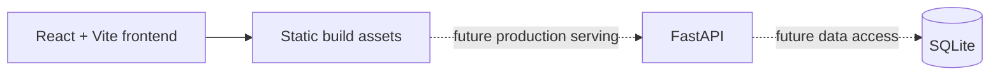
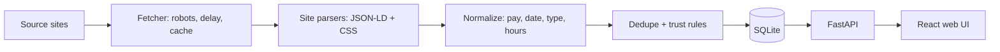

# Architecture

## Current scaffold

The frontend is intentionally independent of the backend during this first iteration. The initial React shell uses local placeholder state only; API calls will be introduced after the FastAPI routes and seeded database exist.

## Target data flow

The scraper and rules engine remain server-side. The UI should display transparent results from those modules and must not make legal or trust determinations on its own.
